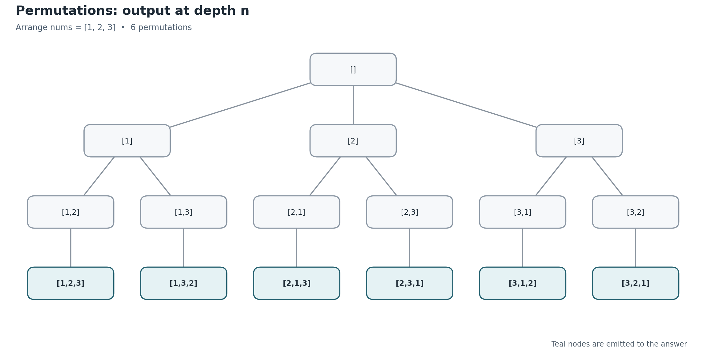
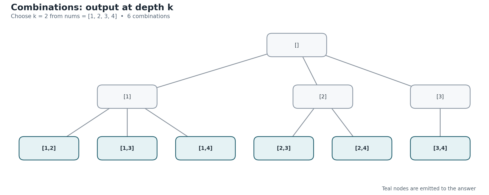
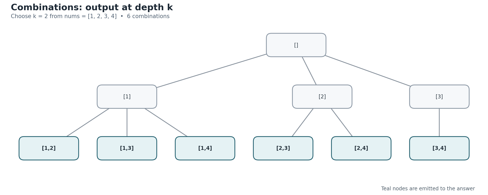

# C++ Backtracking Patterns: Subsets, Combinations, and Permutations

*A practical reference for recursive DFS, iterative DFS using an explicit stack, and non-recursive enumeration. Code targets C++17.*

> **Assumptions:** Unless noted, the input elements are **distinct**, each input position can be selected **at most once**, and the requested output is a collection of vectors. The examples emit copies of complete/valid answers rather than merely counting them.

**Header conventions for the snippets:** each example is a complete function, but uses the following shared aliases and standard-library headers. Copy the relevant function into a file containing:

```cpp
#include <algorithm>
#include <cstdint>
#include <numeric>
#include <stdexcept>
#include <utility>
#include <vector>
using Matrix = std::vector<std::vector<int>>;
```

The [companion `.cpp` file](backtracking_patterns.cpp) is already self-contained, compiles directly, and includes checks for the different implementations.

## 1. Recognize which problem you have

| Question | Subsets | Combinations | Permutations |
|---|---|---|---|
| Is order important? | No | No | **Yes** |
| Must the answer have exactly $k$ elements? | No, any size | **Yes**, exactly $k$ | Usually all $n$; can adapt to $k$ |
| How do we prevent reusing an element? | Only recurse to **later** indices | Only recurse to **later** indices | Keep a **`used`** array |
| When do we append `path` to `result`? | **Every visited node** | Only when `path.size() == k` | Only when `path.size() == n` |
| Number of outputs for distinct inputs | $2^n$ | $\binom{n}{k}$ | $n!$ |
| Common problems | Subsets (LeetCode 78), Subsets II (90) | Combinations (77), Combination Sum III (216) | Permutations (46), Permutations II (47) |

**Fast decision rule:**

1. If every selection of different *sizes* counts, and `[1,2]` is the same answer as `[2,1]`, use **subsets**.
2. If you need *exactly* $k$ elements and selection order does not matter, use **combinations**.
3. If `[1,2]` and `[2,1]` are different answers, use **permutations**.

### Why the recursion looks nearly identical

All three enumerate a *search tree*: choose an element, recurse, and then undo the choice. The key variations are **what candidates remain available** and **which nodes represent finished answers**.

```text
choose candidate
    ↓
modify current path / used flags
    ↓
explore child state
    ↓
undo choice          ← this is backtracking
```

In recursive code, the language's call stack preserves the paused `for` loop at every level. In iterative DFS, **you preserve that state yourself in a stack of frames**.

---

## 2. Subsets — choose zero or more, ignoring order

Example input: `nums = [1,2,3]`.

Outputs in the **for-loop DFS** order used below:

```text
[], [1], [1,2], [1,2,3], [1,3], [2], [2,3], [3]
```



**Invariant:** `path` contains increasing **input indices**. Each recursive call receives a `start` position, so it never revisits an earlier element. Every node (including the empty root) is a valid subset.

### 2.1 Recursive for-loop DFS — the most reusable subset template

```cpp
Matrix subsetsRecursive(const std::vector<int>& nums) {
    const int n = static_cast<int>(nums.size());
    Matrix result;
    std::vector<int> path;

    auto dfs = [&](auto&& self, int start) -> void {
        result.push_back(path);  // Every node is a valid subset.
        for (int i = start; i < n; ++i) {
            path.push_back(nums[i]);
            self(self, i + 1);  // Only move forward: no reordering.
            path.pop_back();    // Undo the choice.
        }
    };

    dfs(dfs, 0);
    return result;
}
```

The important detail is **`result.push_back(path)` before the loop**: subsets may stop at any depth.

### 2.2 Iterative DFS — simulate exactly the same recursion

```cpp
Matrix subsetsIterativeDFS(const std::vector<int>& nums) {
    const int n = static_cast<int>(nums.size());
    struct Frame { int next; };  // Next candidate in this call's for-loop.
    std::vector<Frame> stack{{0}};
    std::vector<int> path;
    Matrix result{{}};           // Emit the root: empty subset.

    while (!stack.empty()) {
        if (stack.back().next == n) {
            stack.pop_back();
            if (!stack.empty()) path.pop_back(); // Undo child choice.
            continue;
        }
        const int i = stack.back().next++;
        path.push_back(nums[i]);
        result.push_back(path);   // Emit on entry to the child.
        stack.push_back({i + 1}); // Simulate dfs(i + 1).
    }
    return result;
}
```

A frame's `next` field represents the value of `i` that the paused recursive `for` loop will try next. When the child frame finishes, remove that child and undo its selection with `path.pop_back()`.

This implementation produces **the same visit/output order** as the recursive for-loop DFS, with $O(n)$ auxiliary memory (excluding results).

### 2.3 Another recursive pattern: include or exclude each element

Some explanations use a binary tree with a yes/no decision for each position:

```cpp
Matrix subsetsIncludeExclude(const std::vector<int>& nums) {
    const int n = static_cast<int>(nums.size());
    Matrix result;
    std::vector<int> path;

    auto dfs = [&](auto&& self, int i) -> void {
        if (i == n) {
            result.push_back(path);
            return;
        }
        self(self, i + 1);     // Exclude nums[i].
        path.push_back(nums[i]);
        self(self, i + 1);     // Include nums[i].
        path.pop_back();
    };

    dfs(dfs, 0);
    return result;
}
```

At depth $i$, you either **exclude** or **include** `nums[i]`. Only the $2^n$ leaves are emitted. This is equivalent to the for-loop DFS in *which subsets it returns*, but the tree shape and output order differ.

### 2.4 Iterative enumeration: bitmasks

```cpp
Matrix subsetsBitmask(const std::vector<int>& nums) {
    const int n = static_cast<int>(nums.size());
    if (n >= 64) throw std::length_error("64-bit mask supports n <= 63");
    Matrix result;
    const std::uint64_t count = std::uint64_t{1} << n;

    for (std::uint64_t mask = 0; mask < count; ++mask) {
        std::vector<int> subset;
        for (int i = 0; i < n; ++i) {
            if (mask & (std::uint64_t{1} << i)) {
                subset.push_back(nums[i]);
            }
        }
        result.push_back(std::move(subset));
    }
    return result;
}
```

Each bit encodes inclusion of one input index. Example `101` with `nums = [1,2,3]` picks `[1,3]`. This is often the shortest **non-recursive enumeration** method for small $n$. The implementation requires $n < 64$ because it uses a 64-bit mask; in practice, storing $2^n$ results becomes infeasible long before that.

### 2.5 Complexity

- Number of results: $$2^n$$
- Time to *materialize* all results: $$\Theta(n2^n)$$ because each emitted subset can require up to $n$ elements to be copied. The **include/exclude** tree itself has $\Theta(2^n)$ nodes.
- Auxiliary working space, excluding results: **$O(n)$** for recursive DFS, iterative DFS, or bitmasks.
- Memory to retain all outputs: **$\Theta(n2^n)$**, counting all stored elements.

---

## 3. Combinations — choose exactly $k$, ignoring order

Example: `nums = [1,2,3,4]`, `k = 2`.

```text
[1,2], [1,3], [1,4], [2,3], [2,4], [3,4]
```



**Difference from subsets:** use the same `start` index and increasing-index invariant, but **emit only at depth $k$**. The loop can prune when too few candidates remain.

### 3.1 Recursive DFS with pruning

```cpp
Matrix combinationsRecursive(const std::vector<int>& nums, int k) {
    const int n = static_cast<int>(nums.size());
    Matrix result;
    if (k < 0 || k > n) return result;
    std::vector<int> path;

    auto dfs = [&](auto&& self, int start) -> void {
        if (static_cast<int>(path.size()) == k) {
            result.push_back(path);  // Only size-k nodes are valid.
            return;
        }
        const int need = k - static_cast<int>(path.size());
        for (int i = start; i <= n - need; ++i) { // Prune short branches.
            path.push_back(nums[i]);
            self(self, i + 1);
            path.pop_back();
        }
    };

    dfs(dfs, 0);
    return result;
}
```

If `need = k - path.size()`, the next index must satisfy `i <= n - need`. Otherwise, too few elements remain to complete a size-$k$ answer. This optimization is safe because indices are strictly increasing.

### 3.2 Iterative DFS — stack-based backtracking

```cpp
Matrix combinationsIterativeDFS(const std::vector<int>& nums, int k) {
    const int n = static_cast<int>(nums.size());
    Matrix result;
    if (k < 0 || k > n) return result;
    struct Frame { int next; };
    std::vector<Frame> stack{{0}};
    std::vector<int> path;

    while (!stack.empty()) {
        if (static_cast<int>(path.size()) == k) {
            result.push_back(path);
            stack.pop_back();
            if (!stack.empty()) path.pop_back();
            continue;
        }
        const int need = k - static_cast<int>(path.size());
        if (stack.back().next > n - need) { // No valid choice left.
            stack.pop_back();
            if (!stack.empty()) path.pop_back();
            continue;
        }
        const int i = stack.back().next++;
        path.push_back(nums[i]);
        stack.push_back({i + 1});
    }
    return result;
}
```

This is the same **paused-loop** transformation as for subsets, with two differences: output at depth `k`, and apply the same upper bound `n - need` to each frame.

### 3.3 Iterative enumeration: next $k$ increasing indices

```cpp
Matrix combinationsLexicographic(const std::vector<int>& nums, int k) {
    const int n = static_cast<int>(nums.size());
    Matrix result;
    if (k < 0 || k > n) return result;

    std::vector<int> idx(k);
    std::iota(idx.begin(), idx.end(), 0); // First: [0, 1, ..., k-1].
    while (true) {
        std::vector<int> combination;
        for (int i : idx) combination.push_back(nums[i]);
        result.push_back(std::move(combination));

        int p = k - 1;                  // Rightmost index we can increase.
        while (p >= 0 && idx[p] == n - k + p) --p;
        if (p < 0) break;               // Last combination was emitted.
        ++idx[p];
        for (int j = p + 1; j < k; ++j) idx[j] = idx[j - 1] + 1;
    }
    return result;
}
```

The algorithm maintains `idx[0] < idx[1] < ... < idx[k-1]`, initially `[0,1,...,k-1]`. To get the next selection, increment the rightmost index that can still move, then reset everything to its right to the smallest legal values. This directly enumerates the **combination indices in lexicographic order**, without a DFS stack.

All three functions handle `k = 0` by returning one empty combination, and `k > n` by returning no combinations.

### 3.4 Complexity

The number of combinations is

$$\binom{n}{k} = \frac{n!}{k!(n-k)!}.$$

- Time to generate and store all combinations with the shown pruning: **$\Theta(k\binom{n}{k})$** for $1 \le k \le n$. The $k=0$ case takes $O(1)$ time. This includes copying each length-$k$ output.
- Recursive / explicit-stack DFS working space: **$O(k)$** for the path and recursion/stack frames (assuming valid $k$).
- Direct lexicographic enumeration working space: **$O(k)$** for the index vector and current output.
- Stored results: **$\Theta(k\binom{n}{k})$** elements for $k \ge 1$.

**Use combinations when:** an answer must contain a fixed number of elements, order is immaterial, and each index can be used at most once (e.g., choosing three team members from ten).

---

## 4. Permutations — order matters

Example input: `nums = [1,2,3]`.

```text
[1,2,3], [1,3,2], [2,1,3], [2,3,1], [3,1,2], [3,2,1]
```



**Difference from subsets/combinations:** do **not** advance a `start` index, because a previously encountered index may still be needed at a later position. Instead, try **every unused** index and track `used[i]`.

### 4.1 Recursive DFS with `used` flags

```cpp
Matrix permutationsRecursive(const std::vector<int>& nums) {
    const int n = static_cast<int>(nums.size());
    Matrix result;
    std::vector<int> path;
    std::vector<bool> used(n, false);

    auto dfs = [&](auto&& self) -> void {
        if (static_cast<int>(path.size()) == n) {
            result.push_back(path); // A complete arrangement.
            return;
        }
        for (int i = 0; i < n; ++i) {
            if (used[i]) continue;
            used[i] = true;
            path.push_back(nums[i]);
            self(self);              // No start index: all unused choices.
            path.pop_back();
            used[i] = false;
        }
    };

    dfs(dfs);
    return result;
}
```

Backtracking undoes **two** operations, in the reverse order: `path.pop_back()` and `used[i] = false`.

### 4.2 Iterative DFS — frame stores its chosen index

```cpp
Matrix permutationsIterativeDFS(const std::vector<int>& nums) {
    const int n = static_cast<int>(nums.size());
    struct Frame {
        int next;     // Next index to test at this recursion level.
        int chosen;   // Index selected by the parent, or -1 for root.
    };
    std::vector<Frame> stack{{0, -1}};
    std::vector<int> path;
    std::vector<bool> used(n, false);
    Matrix result;

    while (!stack.empty()) {
        const bool complete = static_cast<int>(path.size()) == n;
        if (complete) result.push_back(path);
        if (complete || stack.back().next == n) {
            const int chosen = stack.back().chosen;
            stack.pop_back();
            if (chosen >= 0) {
                path.pop_back();
                used[chosen] = false;
            }
            continue;
        }
        const int i = stack.back().next++;
        if (used[i]) continue;
        used[i] = true;
        path.push_back(nums[i]);
        stack.push_back({0, i});   // Simulate recursive call.
    }
    return result;
}
```

Each frame stores `next` (where to resume testing candidates) and `chosen` (the index this call selected from its parent). The latter tells us **which `used` flag to clear** when the frame finishes. The root uses `chosen = -1` because nothing was selected to enter it.

This visits answers in the same order as the recursive DFS.

### 4.3 Iterative enumeration: `std::next_permutation`

```cpp
Matrix permutationsNextPermutation(std::vector<int> nums) {
    std::sort(nums.begin(), nums.end()); // Must start at first ordering.
    Matrix result;
    do {
        result.push_back(nums);
    } while (std::next_permutation(nums.begin(), nums.end()));
    return result;
}
```

Sorting is essential: `std::next_permutation` only advances to **later lexicographic arrangements**, so to enumerate all arrangements you must begin at the smallest one. Unlike index-based DFS, this library method naturally emits **unique value permutations** even if the input contains equal values.

### 4.4 Complexity

- Number of full permutations for distinct inputs: $$n!$$
- Time to produce and store all full permutations: **$\Theta(n\,n!)$**, including each length-$n$ output copy.
- Recursive / explicit-stack DFS working space: **$O(n)$** for the path, `used` flags, and call stack / frames.
- `std::next_permutation` working space: **$O(1)$** beyond the mutable copy of the input ($O(n)$ to keep that copy); sorting adds $O(n\log n)$ time, subsumed by permutation enumeration for nontrivial $n$.
- Stored output size: **$\Theta(n\,n!)$** elements.

**To generate length-$k$ permutations instead of full-length permutations:** stop recursion when `path.size() == k`. For distinct inputs with $0\le k\le n$, there are

$$P(n,k) = \frac{n!}{(n-k)!}$$

such ordered selections. For these, the `used`-flags pattern remains the same.

---

## 5. How to convert recursive backtracking to iterative DFS

The **explicit stack** versions are the direct equivalents of recursion. This is different from enumerating with bitmasks, index counters, or `next_permutation`; those produce the same collection using different algorithms.

| Recursive concept | Iterative equivalent |
|---|---|
| A `dfs(...)` invocation | Push a **frame** onto `stack` |
| Function's `for (i = ...)` loop | Frame's **`next`** candidate index |
| Recursive call on chosen item | Push chosen item onto `path`, then push child frame |
| Base case | Emit an answer when the frame reaches the correct depth |
| Returning from a child call | Pop child frame and **undo** its choice |
| Local `used[i]` modifications | Store `chosen` on the child frame so you can undo them |

**Trace: iterative subsets for `[1,2]`**

| Event | `path` | Emitted answer |
|---|---|---|
| Enter root | `[]` | `[]` |
| Choose index `0` | `[1]` | `[1]` |
| Child chooses index `1` | `[1,2]` | `[1,2]` |
| Child finishes; undo `2` | `[1]` | — |
| Parent finishes; undo `1` | `[]` | — |
| Root chooses index `1` | `[2]` | `[2]` |

The crucial implementation rule is: **advance the parent's `next` before pushing a child frame**. Otherwise you retry the same candidate forever when the child returns.

## 6. Variations and common traps

### Inputs with duplicate values

The core recursive/explicit-stack algorithms treat *indices* as distinct. Thus `nums = [1,1,2]` creates duplicate **value** results unless you explicitly deduplicate.

For **unique subsets / combinations**: sort a mutable copy of `nums`, and inside the DFS `for` loop skip duplicates *at the same recursion depth*:

```cpp
if (i > start && nums[i] == nums[i - 1]) continue;
```

For **unique permutations**: sort first, and inside the DFS `for` loop (after the standard `if (used[i]) continue;`) add:

```cpp
if (i > 0 && nums[i] == nums[i - 1] && !used[i - 1]) continue;
```

This imposes a canonical ordering on identical values. For an iterative explicit-stack DFS, put the corresponding `continue` inside the candidate-testing step as well. The `std::next_permutation` alternative already handles duplicate values without repeated value arrangements when started from sorted input.

### Repetition allowed vs. no repetition

- **Combinations where an element may be selected again:** recurse with `dfs(i)` instead of `dfs(i+1)` (assuming constraints prevent infinite recursion, such as a remaining positive target or maximum path length).
- **Ordered sequences where elements may repeat:** don't use `used[]`; choose any of the $n$ candidates at each of $k$ positions. There are $n^k$ sequences.
- **Combinations or subsets from `1..n`:** you do not need an input vector; put the selected **number** into `path` rather than `nums[i]`.

### Frequent implementation errors

- Emitting only at leaves in a subsets for-loop DFS: this **misses** shorter subsets. (The separate include/exclude binary tree *does* emit at leaves because every leaf fixes all include/exclude decisions.)
- Using `dfs(i)` instead of `dfs(i+1)` when reuse is disallowed.
- Using a `start` index for permutations: this wrongly eliminates orders such as `[2,1]`.
- Forgetting to undo `path.push_back()` or `used[i] = true` after exploring a branch.
- Forgetting the empty answer: there is **one empty subset**, **one size-0 combination**, and conventionally **one empty permutation** of an empty input.
- Comparing the order of answers across *different* enumeration algorithms: the collection can be correct even if emitted in another order.
- Calling an algorithm $O(2^n)$ while storing all its subsets: copying the output makes the full **time and stored-output size** $\Theta(n2^n)$.

## 7. Interview-ready cheat sheet

```text
SUBSETS (all sizes; order doesn't matter)
  dfs(start):
      emit(path)                // every node
      for i = start .. n-1:
          take(i); dfs(i+1); undo(i)

COMBINATIONS (exactly k; order doesn't matter)
  dfs(start):
      if size(path) == k: emit(path); return
      need = k - size(path)
      for i = start .. n-need: // prune insufficient suffix
          take(i); dfs(i+1); undo(i)

PERMUTATIONS (order matters; no repeats)
  dfs():
      if size(path) == n: emit(path); return
      for i = 0 .. n-1:
          if used[i]: continue
          used[i] = true; take(i)
          dfs()
          undo(i); used[i] = false

ITERATIVE DFS CONVERSION
  stack frame = next candidate + (if needed) chosen index
  advance parent frame → choose → push child frame
  base case or no candidates → emit (when appropriate) → pop → undo
```

## 8. Practice progression

1. **Subsets (78):** implement both the `start`-index DFS and bitmask enumeration; compare unordered collections.
2. **Combinations (77):** choose $k$ numbers from `1..n`, then implement the pruning bound `n - need`.
3. **Permutations (46):** implement the `used[]` DFS and the explicit-stack equivalent.
4. **Subsets II (90) / Permutations II (47):** add duplicate skipping and explain why sorting is required.
5. **Combination Sum (39):** decide why same-index recursion is necessary when reuse is permitted.
6. **Combination Sum II (40):** combine no-reuse recursion, duplicate skipping, and a remaining-sum constraint.

## 9. Source files and diagram downloads

- [Complete, tested C++17 implementations](backtracking_patterns.cpp) — includes `main()` with assertions comparing each equivalent implementation on distinct inputs.
- [Subset search tree (PNG)](figures/subsets_tree.png)
- [Combination search tree (PNG)](figures/combinations_tree.png)
- [Permutation search tree (PNG)](figures/permutations_tree.png)

Compile and run the companion code:

```bash
g++ -std=c++17 -O2 -Wall -Wextra -pedantic backtracking_patterns.cpp -o patterns
./patterns
```

All image links are **relative to this Markdown file**, so keep the `figures/` directory next to the `.md` file or extract the supplied ZIP archive as-is.
